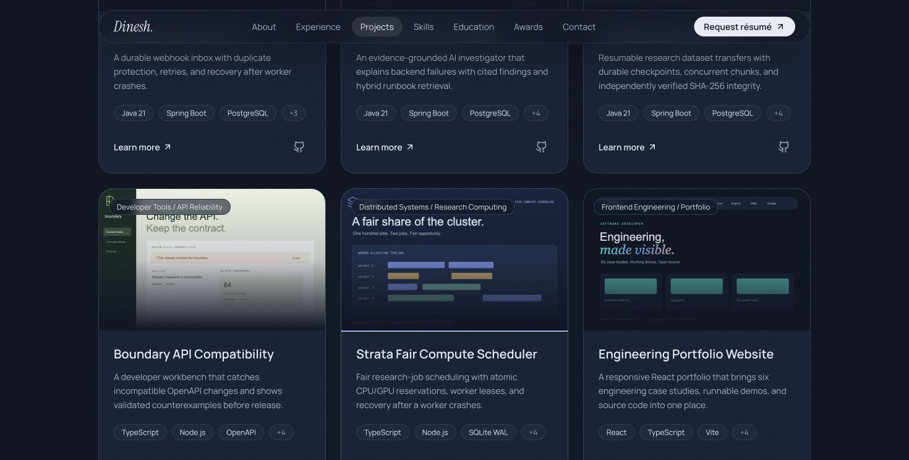
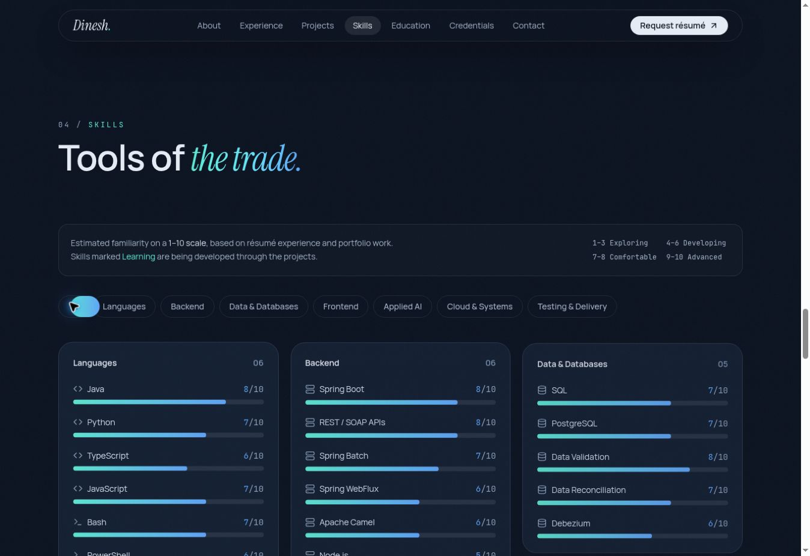
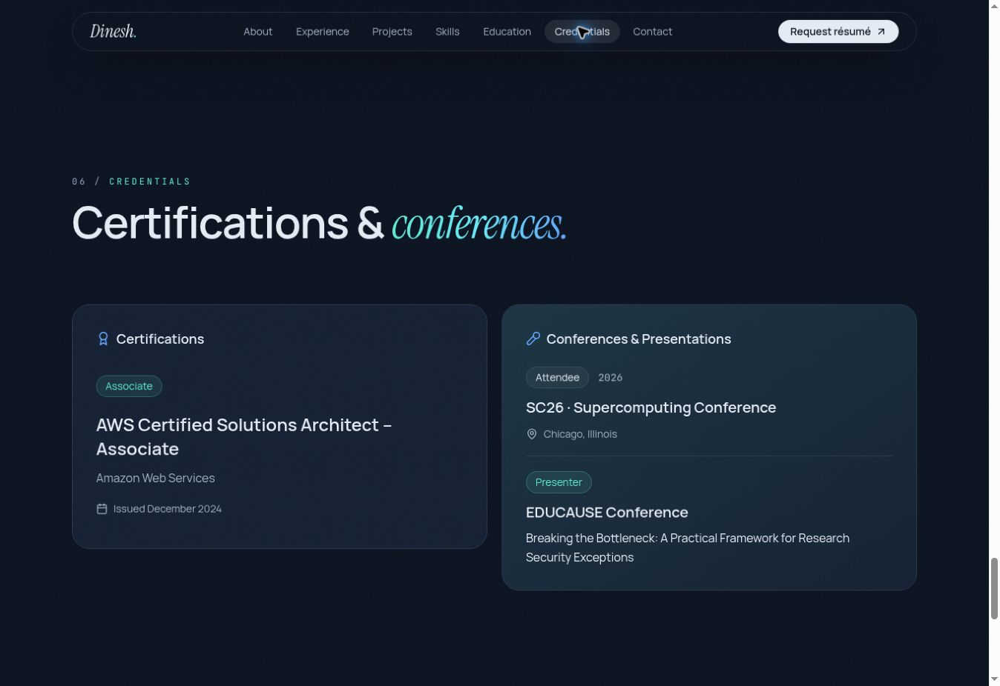

# Dinesh Kumar Rama — Engineering Portfolio

A responsive React and TypeScript website connecting six engineering case studies to their working demos, source code, and learning material.

[Live portfolio](https://dk18234.github.io/dinesh-rama-portfolio/) · [Project hub](https://dk18234.github.io/webhook-recovery-lab/projects/) · [Beginner learning guide](guide/LEARNING.md)



The supplied website design was adapted and personalized with AI assistance. Its original layout, colors, fonts, animation language, section order, navigation, filters, six-card grid, and project dialogs are retained. The original template design is not claimed as original work.

## Six projects

| Project | Focus |
|---|---|
| Webhook Recovery Lab | Durable delivery, duplicate protection, fenced workers |
| TraceLens AI Investigator | Local language models, evidence, hybrid retrieval |
| Relay Dataset Transfers | Resumable byte transfers and integrity verification |
| Boundary API Compatibility | Directional OpenAPI checks and concrete counterexamples |
| Strata Fair Compute Scheduler | Fair admission, atomic reservations, lease recovery |
| Engineering Portfolio Website | React presentation, responsive navigation, project exploration |

The final card describes this website itself. Its source link points here and its demo opens the deployed portfolio.

## Skills and credentials

The skills section uses estimated 1–10 familiarity ratings with visible bars and category filters. New portfolio topics are marked as learning. Certifications and Conferences & Presentations include AWS Solutions Architect – Associate, SC26 attendance, and the supplied EDUCAUSE presentation title.





## Run locally

Use Node.js 24 and npm:

```bash
npm ci
npm run verify
npm run dev
```

`npm run build` creates a root-hosted build in `dist/`. `npm run build:pages` creates the GitHub Pages build in `docs/` with the `/dinesh-rama-portfolio/` base path. After both builds, `npm run verify:dist` checks their asset paths. GitHub Pages serves `main /docs`.

## Implementation

- `src/data.ts`: typed project records, technologies, experience, education, contact links, and asset URLs.
- `src/App.tsx`: section components, stateful filters, animated cards, project dialogs, mobile navigation, and section observation.
- `src/index.css`: existing Tailwind layers and original presentation effects.
- `public/images/`: public monogram and project artwork.
- Personal portrait and résumé files are excluded from this public repository; visitors can request the résumé by email.
- `scripts/`: project completeness and root/subpath build verification.
- `.github/workflows/verify.yml`: reproducible builds and published-output freshness.

Project dialogs support Escape, keyboard focus containment, and focus restoration to the opening control. Reduced-motion preferences are respected. No WCAG certification, analytics, backend database, or contact-message delivery service is claimed.

Personal facts come from supplied material. Skills show estimated familiarity on a 1–10 scale with visible bars, with new portfolio topics marked as learning. Certifications and conferences replace awards and publication placeholders: AWS Solutions Architect – Associate (December 2024), SC26 attendance, and the supplied EDUCAUSE presentation title. Unprovided EDUCAUSE date and session URL are omitted. All six **project entries** are complete. The public version uses a monogram and a résumé-request link. The existing managed personal site retains the supplied portrait and résumé. No work experience or credentials are fabricated.

## Content and deployment

Update project data centrally and keep asset paths based on `import.meta.env.BASE_URL`. Keep demo/source URLs absolute so project links work from either host. The existing managed website uses its existing deployment identity and audience; this public repository contains sanitized application source without hosting credentials or private deployment configuration.

The application has no runtime secrets. Source configuration and local databases belonging to the other projects are not included. Each project repository has its own runnable backend, evidence, and learning material.

See [architecture and design notes](guide/ARCHITECTURE.md), [learning guide](guide/LEARNING.md), and [verification](guide/VERIFICATION.md).
