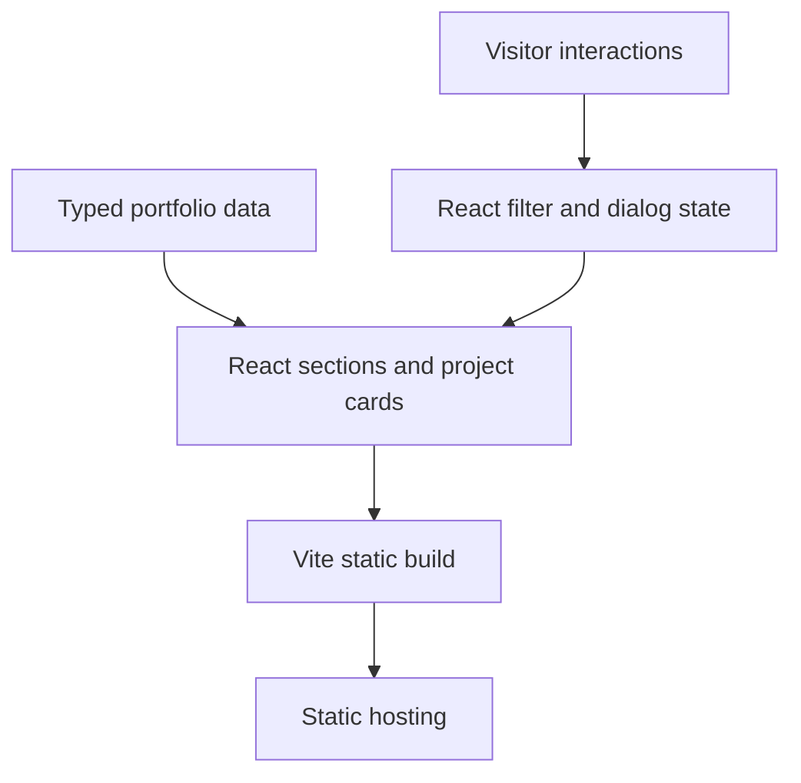

# Architecture and design notes

The portfolio is a static application. React renders typed data, Vite bundles source and assets, and a static host serves the result. There is no need for a database or account system to show professional content and link to independent demos.

## Interaction model

Project filters select records by the existing group field. Cards open a shared detail dialog. Dialog content comes from the same record as the card, so titles, technologies, source links, and demo links stay consistent. Escape closes the dialog. Tab and Shift+Tab remain inside its controls; closing restores the opening control's focus.

Mobile navigation uses local open state. Section observation updates the active navigation item. Framer Motion handles the original reveal and layout animations, with reduced-motion preferences respected. These mechanisms are presentation behavior, not claims of production-scale system design.

## Deployment paths

Root hosting builds to `dist/` with base `/`. GitHub Pages builds to `docs/` with base `/dinesh-rama-portfolio/`. Asset URLs use the Vite base URL. External project demos and source links are absolute. The checks verify both generated script/style paths and the public assets.

The public source excludes managed-host identity, credentials, repository internals, dependency folders, and local build scratch. The existing managed deployment retains its current audience. Its source manifest is maintained only in its own hosted checkout.

## Scope and attribution

The original supplied visual design is preserved. This project demonstrates personalization, typed content modeling, React integration, deployment, project presentation, and interaction refinement. It does not claim original authorship of the supplied template design or production customer usage. No upstream license was supplied with the source; no new license grant for that original material is asserted here.
